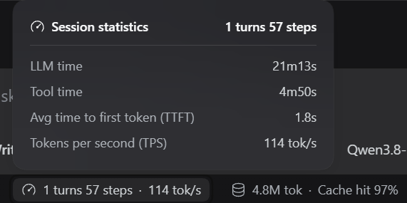
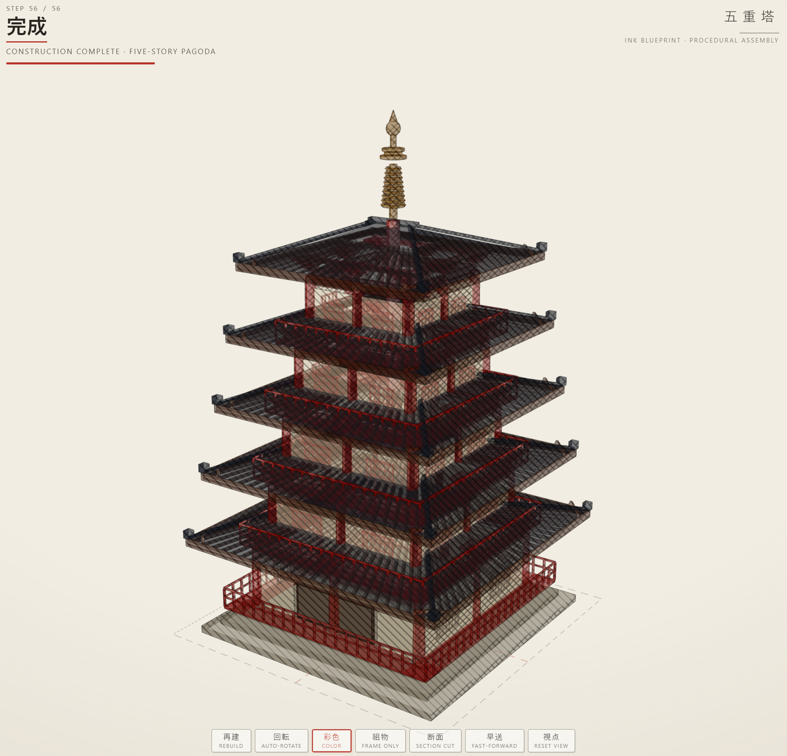

ก่อนหน้านี้ใช้ [Qwen3.8-27b](https://huggingface.co/Qwen/Qwen3.8-27B) อยู่แล้วบนเครื่อง I7-13700k, RTX 3090, 64GB DDR@ 5200mhz  โดยตอนแรกใช้ [LM Studio](https://lmstudio.ai/) แต่พอย้ายมาใช้ [HyperQwen](https://github.com/syv-ai/HyperQwen) จำนวน token/s ก็พุ่งจาก 35 เป็น 100+ token/s (แต่พอใช้ไปสักพักจะตกเหลือ 70 token/s) สำหรับ 131k context length และจะตกมาเหลือ 35k token/s เช่นเดิมถ้าใช้ 252k context length

ด้วยความที่มี [Qwen3.8-flash-next](https://huggingface.co/Qwen/Qwen3.8-Flash-Next) ออกใหม่ก็ว่าจะนำมาลองบ้าง โดย Inference engine ก็มีเลือกหลากหลายทั้ง [oLLAMA](https://ollama.com/) [vLLM](https://vllm.ai/) [llama.cpp](https://github.com/ggml-org/llama.cpp) แต่ที่ขึ้นผ่านฟีดบ่อยๆ ก็เห็นจะเป็น [Strata](https://github.com/niko1221/strata) เลยมาลองติดตั้งดู 

โดยวิธีติดตั้งนั้นก็ออกจะยาว ก็ให้ Deepseek Harness ติดตั้งให้ซะเลย


```text
Could you ssh to <username>@<ip> (password <password>)
Set up Strata (https://github.com/Niko1221/Strata) and set it up with Qwen3.8-Flash-Next (IQ3_S).
Enable vision (allow it to read images).
Please aim to run it with a `262144` context length first. If not able. I also allow you to drop to `131072 ` context length.
Once setup is done. In this Deepseek Harness (DSH) add this new Qwen3.8-Flash-Next under `<password>` provider
```

พอติดตั้งแล้วลองรันให้สร้าง [five story pagoda](https://www.reddit.com/r/VibeCodePrompts/comments/1x381ll/one_prompt_one_html_file_a_japanese_pagoda_that/) ดู ด้วย prompt

```text
Build a single-file HTML page (Three.js from a CDN, no build step) that shows a complex building assembling itself piece by piece, as if from an architect's blueprint. 
Subject: a traditional Japanese five-story wooden pagoda (gojūnotō), modeled procedurally in code from real structural parts — stone podium, central pillar, columns, tie beams, doors and lattice windows, verandas with railings, three-step bracket sets, purlins, rafters, eave boards, tiled roofs, and the sōrin finial on top. 
Look: an ink drawing on warm paper (#f2eee4 paper, #2a2520 ink, red accent #b8352a). Render faces with a hatching shader and draw crisp edge lines over them, so it reads as a technical drawing rather than a shaded 3D model. Before anything is built, show the whole building as a faint ghost wireframe — the "blueprint" — that the real parts then fill in. Animation: parts appear in true construction order, bottom to top, tier by tier, each one dropping or sliding into place. Show a step counter and the name of the part currently being assembled, in Japanese with an English subtitle. When the build finishes, fade in color. 
Controls (buttons along the bottom, Japanese label with a small English caption): rebuild, auto-rotate, color on/off, frame-only (structure without walls and roofs), section cut (clip the building in half to see inside), fast-forward, reset view. Orbit with the mouse. Must work on mobile.
```

ปรากฏรอบแรก ระเบิดเลย strata มีปัญหากับ [Deepseek Harness](https://github.com/deepseek-ai/deepseek-harness) ที่ใช้อยู่ ไม่สามารถใช้ Tool calling ได้ เลยให้ Deepseek เขียน [dsh-strata-toolcalling-fix](https://github.com/pureexe/dsh-strata-toolcalling-fix) เพื่อแก้ปัญหาที่เกิดขึ้น

โดยสามาถรันได้ถึง 114 token/s



จากนั้นจึงสามารถสร้าง pagoda ออกมาได้อย่างสวยงาม




โดยสามารถดูได้ที่ JSFiddle [https://jsfiddle.net/pureexe/cet3rkpj/](https://jsfiddle.net/pureexe/cet3rkpj/)

